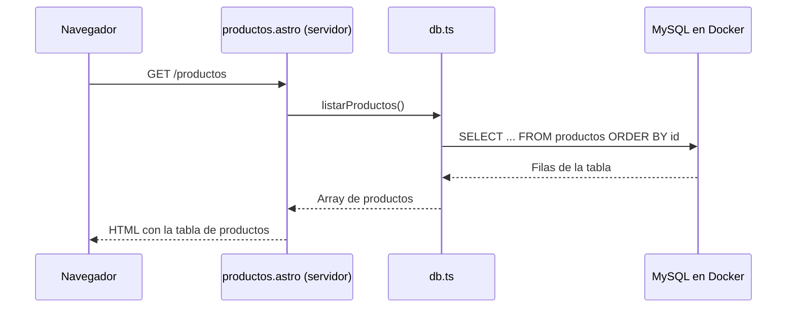

# Cómo funciona el ejemplo de Astro con MySQL

Este documento explica los ficheros creados o modificados para mostrar los
productos de una base de datos MySQL en la página `/productos`. También describe
los ficheros existentes que utiliza esa página.

Para ejecutar el ejemplo, sigue los comandos del [README](../README.md).

## 1. Recorrido de una petición



Astro y MySQL son dos procesos distintos. En este ejemplo, Astro se ejecuta con
Node.js en el equipo, mientras que MySQL se ejecuta dentro de Docker. El código
del servidor de Astro consulta la BD y genera el HTML que recibe el navegador.

## 2. Mapa de ficheros

| Fichero | Función |
| --- | --- |
| `compose.yaml` | Define el contenedor MySQL, sus variables, puertos, almacenamiento y comprobación de salud. |
| `.env.example` | Contiene una plantilla de configuración local. |
| `.env` | Guarda la configuración utilizada en tu equipo; lo creas copiando la plantilla. |
| `docker/mysql/init.sql` | Crea la tabla e inserta cuatro productos de ejemplo. |
| `src/lib/db.ts` | Gestiona las conexiones a MySQL y la consulta de productos. |
| `src/pages/productos.astro` | Obtiene los productos y los muestra en una tabla HTML. |
| `src/components/Menu.astro` | Permite acceder a la página desde el menú. |
| `package.json` | Declara las dependencias y los comandos del proyecto. |
| `package-lock.json` | Registra las versiones exactas instaladas por npm. |
| `README.md` | Explica cómo arrancar, consultar y detener el ejemplo. |

## 3. `compose.yaml`: el contenedor de la base de datos

Este fichero describe el servicio `mysql` para Docker Compose. Cuando ejecutas
`docker compose up`, Docker utiliza esta definición para crear el contenedor.

### Imagen

`image: mysql:8.4` indica qué imagen de MySQL debe utilizarse. La etiqueta `8.4`
selecciona esa serie de versiones; no fija un parche concreto.

### Variables de inicialización

La sección `environment` entrega estas variables al contenedor:

| Variable dentro del contenedor | Valor tomado de `.env` | Para qué sirve |
| --- | --- | --- |
| `MYSQL_ROOT_PASSWORD` | `MYSQL_ROOT_PASSWORD` | Establece la contraseña del administrador. |
| `MYSQL_DATABASE` | `DB_NAME` | Crea la base de datos del ejemplo. |
| `MYSQL_USER` | `DB_USER` | Crea el usuario de la aplicación. |
| `MYSQL_PASSWORD` | `DB_PASSWORD` | Establece su contraseña. |

Expresiones como `${DB_NAME:?Falta DB_NAME en .env}` hacen que Compose muestre
un error si falta una variable obligatoria o su valor está vacío.

Estas variables inicializan MySQL cuando el directorio de datos está vacío.
Modificar `.env` después no cambia automáticamente los usuarios, contraseñas
ni bases de datos que ya existan.

### Puertos

La línea `127.0.0.1:${DB_PORT:-3307}:3306` conecta el puerto del equipo con el
puerto del contenedor:

- `127.0.0.1`: publica MySQL en la interfaz local del equipo.
- `${DB_PORT:-3307}`: utiliza `DB_PORT` o, si falta o está vacío, el puerto 3307.
- `3306`: es el puerto de MySQL dentro del contenedor.

Por eso Astro se conecta a `127.0.0.1:3307` con los valores de ejemplo.

### Volúmenes

`mysql_data:/var/lib/mysql` conserva los datos en un volumen gestionado por
Docker. Retirar el contenedor con `docker compose down` mantiene ese volumen.

`./docker/mysql/init.sql:/docker-entrypoint-initdb.d/01-init.sql:ro` hace que el
SQL del proyecto esté disponible en el directorio de inicialización de MySQL.
El sufijo `ro` significa que el fichero se monta en modo de solo lectura.

### Comprobación de salud

El `healthcheck` intenta ejecutar `SELECT 1` con el usuario de la aplicación
contra la base de datos configurada. Así comprueba que acepta una consulta
autenticada. El comando de arranque del README usa `--wait` para esperar a que
el contenedor esté listo.

`interval`, `timeout`, `retries` y `start_period` controlan cada cuánto se
comprueba, cuánto puede tardar cada intento, cuántos fallos se admiten y el
periodo inicial de arranque.

Los signos `$$` permiten que variables como `$${MYSQL_USER}` lleguen al
contenedor para que su intérprete de comandos las expanda allí, en vez de
interpolarlas Compose con las variables del equipo.

## 4. `.env.example` y `.env`: la configuración

[`.env.example`](../.env.example) es una plantilla que se puede guardar en Git.
Incluye valores de ejemplo para el entorno local. El comando
`cp .env.example .env` crea tu configuración a partir de ella.

El fichero `.env` contiene los valores que usarán Compose y Astro en desarrollo:

- `DB_HOST` y `DB_PORT`: indican dónde conectar desde Astro.
- `DB_NAME`: selecciona la base de datos.
- `DB_USER` y `DB_PASSWORD`: identifican al usuario de la aplicación.
- `MYSQL_ROOT_PASSWORD`: permite inicializar el usuario administrador de MySQL.

Compose traduce algunas de estas variables a los nombres `MYSQL_*` que espera
la imagen. El módulo `db.ts` lee las variables `DB_*` mediante la API de servidor
de Astro. La conexión de la aplicación utiliza `DB_USER`, no el usuario root.

`.env` ya está excluido de Git por el [`.gitignore`](../.gitignore) existente.
Las credenciales de la plantilla son únicamente un ejemplo para desarrollo local.

## 5. `docker/mysql/init.sql`: la estructura y los datos

Este [script SQL](../docker/mysql/init.sql) prepara el contenido inicial de la BD.
La imagen de MySQL lo ejecuta automáticamente cuando inicializa un volumen vacío,
dentro de la base de datos indicada por `MYSQL_DATABASE`.

`SET NAMES utf8mb4` configura la codificación de la conexión que importa el SQL.
La tabla también declara `utf8mb4`, para poder almacenar texto Unicode.

La instrucción `CREATE TABLE productos` crea estas columnas:

| Columna | Tipo | Significado |
| --- | --- | --- |
| `id` | `INT UNSIGNED AUTO_INCREMENT PRIMARY KEY` | Identificador único, positivo y generado automáticamente. |
| `nombre` | `VARCHAR(120) NOT NULL` | Nombre obligatorio, de hasta 120 caracteres. |
| `descripcion` | `VARCHAR(255) NOT NULL` | Descripción obligatoria, de hasta 255 caracteres. |
| `precio` | `DECIMAL(10, 2) UNSIGNED NOT NULL` | Importe no negativo, con diez dígitos en total y dos decimales. |
| `stock` | `INT UNSIGNED NOT NULL DEFAULT 0` | Cantidad no negativa; si se omite al insertar, se guarda 0. |

Después, `INSERT INTO productos` añade cuatro filas. Una tiene stock 0 para
mostrar el estado «Agotado» en la página.

Editar este script no modifica una base de datos ya inicializada. Para cambiar
datos existentes puedes ejecutar SQL desde el cliente del contenedor, como
explica el README. Recrear el volumen vuelve a ejecutar la inicialización, pero
borra los datos anteriores.

## 6. `src/lib/db.ts`: la conexión y la consulta

Este [módulo TypeScript](../src/lib/db.ts) concentra el acceso a la BD. La página
lo importa desde su código de servidor.

### Importaciones y tipo `Producto`

`getSecret`, de `astro:env/server`, obtiene las variables de entorno en el
servidor. `mysql2/promise` proporciona un cliente MySQL que permite usar
`async` y `await`.

La interfaz `Producto` describe la forma de cada fila devuelta por la consulta.
Extiende `RowDataPacket`, el tipo de fila del cliente MySQL2. Esta interfaz ayuda
a TypeScript a comprobar el código; no crea la tabla ni valida los datos en
tiempo de ejecución.

El campo `precio` se declara como `string` porque MySQL2 devuelve los valores
`DECIMAL` como texto por defecto para conservar su precisión.

### `getPool()`

Un pool es un conjunto de conexiones reutilizables. La variable `pool` se guarda
en el módulo y empieza sin valor. La primera llamada a `getPool()` lo configura;
las siguientes reutilizan la misma instancia mientras el módulo siga cargado.

Antes de crearlo, `required()` comprueba que las variables necesarias tienen
valor. También se convierte `DB_PORT` a número y se comprueba que sea un entero
entre 1 y 65535.

`mysql.createPool()` recibe la configuración de conexión. Sus opciones incluyen:

- `charset: 'utf8mb4'`: utiliza Unicode en la conexión.
- `connectionLimit: 5`: limita el pool a cinco conexiones.
- `connectTimeout: 5000`: da cinco segundos para establecer una conexión; no es
  un límite de duración de las consultas.

El pool abre las conexiones cuando hacen falta para atender consultas. Esta
inicialización diferida permite compilar el proyecto sin consultar MySQL.

### `listarProductos()`

La función ejecuta esta consulta fija:

```sql
SELECT id, nombre, descripcion, precio, stock FROM productos ORDER BY id;
```

`await` espera a que termine la consulta. MySQL2 devuelve los datos y la
información de las columnas; `const [productos]` recoge únicamente los datos.
La función devuelve un `Promise<Producto[]>`, es decir, una operación asíncrona
cuyo resultado es un array de productos.

Si ocurre un error, la función lo propaga para que lo gestione la página.

### Recarga durante el desarrollo

El bloque `import.meta.hot.dispose()` cierra el pool cuando Vite sustituye este
módulo durante una recarga de desarrollo. Así libera sus conexiones anteriores.

## 7. `src/pages/productos.astro`: la página

Astro convierte el nombre de este [fichero](../src/pages/productos.astro) en la
ruta `/productos`.

### Bloque de servidor

El código entre los delimitadores `---` importa el layout y la función de
consulta. La línea `export const prerender = false` hace que esta ruta se
renderice en el servidor cuando llega una petición.

Dentro de `try`, la página llama a `await listarProductos()`. Si la consulta
falla, el bloque `catch` registra el error en el servidor, establece el estado
HTTP 503 y activa la variable `error`. El visitante recibe un mensaje genérico.

`Intl.NumberFormat` prepara el formato de moneda española en euros. Antes de
formatear cada precio se convierte el texto recibido de MySQL a número; por
ejemplo, `59.90` se muestra como `59,90 €`.

### Plantilla HTML

El contenido se introduce en `BaseLayout` y contempla tres resultados:

1. Si falla la consulta, muestra un mensaje con `role="alert"`.
2. Si la consulta devuelve cero filas, muestra que todavía no hay productos.
3. Si hay productos, genera una fila por producto con `productos.map()`.

`caption` indica el número de productos y `scope` relaciona las cabeceras con
sus columnas o filas. El stock 0 se representa con la palabra «Agotado».

Los valores se insertan con expresiones como `{producto.nombre}`. Astro escapa
ese contenido al generar el HTML. La página no necesita JavaScript propio en el
navegador para consultar MySQL: la tabla llega renderizada desde el servidor.

### Estilos

El bloque `<style>` define estilos locales del componente. Limita la anchura del
contenido, añade separación y bordes a las celdas y permite desplazamiento
horizontal cuando la tabla no cabe en la pantalla.

## 8. `src/components/Menu.astro`: acceso desde el menú

En este [componente existente](../src/components/Menu.astro) se añadió el enlace:

```html
<a href="/productos">Productos MySQL</a>
```

Como `BaseLayout` incluye `Menu`, el enlace aparece en las páginas que utilizan
ese layout. El enlace permite navegar; la consulta se realiza en la página de
destino.

## 9. `package.json`: dependencia y comandos

En [`package.json`](../package.json) se añadió `mysql2` a `dependencies` porque
el servidor necesita ese cliente para consultar MySQL también al ejecutar la
aplicación compilada.

Los scripts existentes permiten arrancar Astro (`npm run dev`), compilar
(`npm run build`) y ejecutar comandos de su CLI (`npm run astro -- ...`). El README
utiliza `npm run dev -- --background` para iniciar el servidor en segundo plano.

## 10. `package-lock.json`: instalaciones reproducibles

[`package-lock.json`](../package-lock.json) lo actualizó npm al instalar MySQL2.
Registra las versiones exactas, sus dependencias y los datos para verificar las
descargas. `package.json` declara los rangos permitidos; el lockfile concreta la
instalación resuelta.

`npm ci` instala lo registrado en el lockfile y comprueba su coherencia con
`package.json`. Este fichero se mantiene mediante npm.

## 11. `README.md`: instrucciones de uso

El [README](../README.md) reúne los requisitos y los comandos para preparar
`.env`, iniciar MySQL, arrancar Astro, modificar productos y consultar los logs.
También explica cómo detener los servicios conservando los datos y cómo recrear
la BD borrando el volumen si se desea reiniciar el ejemplo.

Incluye los comandos de compilación y de ejecución del resultado con Node.js.
En ese último caso, `--env-file=.env` carga las variables para el proceso del
servidor compilado.

## 12. Ficheros existentes que completan el ejemplo

### `src/layouts/BaseLayout.astro`

Este [layout](../src/layouts/BaseLayout.astro) aporta el documento HTML compartido,
incluye el menú y coloca el contenido de la página en `<slot />`. También incluye
`ClientRouter`, que gestiona las transiciones de navegación de Astro.

### `astro.config.mjs`

La [configuración de Astro](../astro.config.mjs) ya incluía el adaptador
`@astrojs/node` en modo `standalone`. Este adaptador permite ejecutar las rutas
que necesitan servidor, como `/productos`, y generar una entrada ejecutable en
`dist/server/entry.mjs` al compilar.

El proyecto conserva páginas prerenderizadas y esta ruta de servidor gracias a
`prerender = false` en `productos.astro`.

### `.gitignore`

Este [fichero](../.gitignore) ya excluye `.env`, `node_modules/`, `.astro/` y
`dist/`. Así, la configuración local, las dependencias instaladas y los ficheros
generados no se incorporan al repositorio. La plantilla `.env.example` sí puede
compartirse para que otra persona prepare su entorno.

## 13. Qué fichero cambiar en cada caso

| Cambio deseado | Fichero o acción |
| --- | --- |
| Cambiar las credenciales de una instalación nueva | Editar `.env` antes de inicializar MySQL. |
| Cambiar el puerto local de MySQL | Editar `DB_PORT` en `.env`, recrear el contenedor y reiniciar Astro. |
| Cambiar los datos iniciales para instalaciones nuevas | Editar `docker/mysql/init.sql`. |
| Modificar productos de una BD existente | Ejecutar `INSERT`, `UPDATE` o `DELETE` con el cliente MySQL. |
| Cambiar los campos u orden que consulta Astro | Editar la consulta y el tipo `Producto` de `src/lib/db.ts`. |
| Cambiar las columnas o el diseño de la página | Editar `src/pages/productos.astro`. |
| Cambiar el texto del enlace del menú | Editar `src/components/Menu.astro`. |
| Cambiar la imagen o el almacenamiento de MySQL | Editar `compose.yaml`. |

## Referencias

- [Rutas en Astro](https://docs.astro.build/en/guides/routing/).
- [Componentes de Astro](https://docs.astro.build/en/basics/astro-components/).
- [Variables de entorno de Astro](https://docs.astro.build/en/guides/environment-variables/).
- [Estilos en Astro](https://docs.astro.build/en/guides/styling/).
- [Cliente MySQL2](https://sidorares.github.io/node-mysql2/docs).
- [Imagen oficial de MySQL](https://hub.docker.com/_/mysql).
